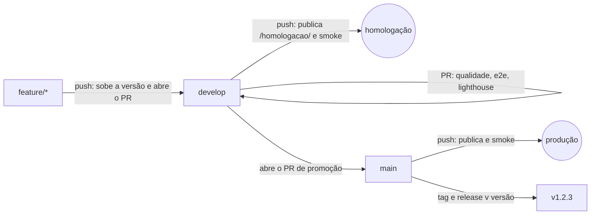

# Pipeline único dos playgrounds

Pipeline único de CI/CD dos playgrounds da Sertão será cloud: DivergeGo, DivergeKubernetes, DivergePHP, DivergePython e DivergeTerraform.

A lógica fica neste repositório, num **workflow reutilizável** ([`.github/workflows/playground.yml`](../../.github/workflows/playground.yml)). Cada playground tem só um arquivo pequeno que chama esse workflow com `uses: ...@pipeline-v1` e passa os secrets com `secrets: inherit`.

## Gitflow



| Evento no playground | Jobs que rodam |
|---|---|
| push em `feature/**` | `feature-pr`: sobe a versão patch (uma vez por versão de `develop`) e abre ou atualiza o PR para `develop` |
| `pull_request` para `develop` ou `main` | `qualidade` (lint, astro check, arquivos comuns, testes com cobertura, npm audit), `e2e` (Chromium, bloqueia), `e2e-outros` (Firefox, WebKit e celular, informativo) e `lighthouse` |
| push em `develop` | os portões e depois `principal` + `homologacao` → `montar` → `publicar` (GitHub Pages) → `smoke` → `promover` (PR `develop` → `main`) |
| push em `main` | os portões e depois a publicação, `smoke` e `tag` (tag e release `v<versão do package.json>`) |
| `workflow_dispatch` | igual a um push no branch escolhido |
| `schedule` | `auditoria-lighthouse` (Lighthouse no site no ar) e `auditoria-comuns` (arquivos comuns entre os playgrounds) |

Cada publicação monta o site inteiro (o `main` na raiz e o `develop` em `/homologacao/`), para uma nunca apagar a outra. Só uma publicação roda por vez em cada repositório, e nenhuma é cancelada no meio.

**Migração para TypeScript** (ADR 0003): a `qualidade` roda `npm run tipos` e `npm run test:contrato`, e o `e2e` roda `npm run test:componentes` (Vitest num Chromium de verdade). Cada passo só roda quando o repositório tem o script. Os nomes dos checks não mudam, então os rulesets continuam valendo.

**Certificados já emitidos:** antes de publicar, o job `montar` compara a chave pública do build (`chave-publica-ed25519.txt`) com a que já está no ar, em produção e na homologação. Se for diferente, a publicação para. Uma chave nova quer dizer que o segredo dos certificados mudou, e aí todo selo emitido deixaria de conferir. Na primeira publicação, sem chave no ar, o job só avisa. O contrato completo está no [ADR 0003](../adr/0003-typescript-e-react-100.md).

## Como usar num playground

Copie [`docs/pipeline/exemplo.yml`](exemplo.yml) para `.github/workflows/pipeline.yml` e ajuste os `with:`:

```yaml
jobs:
  pipeline:
    uses: sertaoseracloud/playground-ui/.github/workflows/playground.yml@pipeline-v1.0.2
    with:
      titulo: 'DivergePHP:'
    secrets: inherit
```

| Entrada | Padrão | Para que serve |
|---|---|---|
| `titulo` | (obrigatória) | Começo do `<title>` que o smoke test procura, como `DivergePHP:` ou `DivergeGo` |
| `node-version` | `24` | Versão do Node |
| `go-version` | vazio | Versão do Go para o build. Só o DivergeGo usa (`1.26.x`), por causa do runtime em WebAssembly |
| `astro-check` | `false` | Roda `npm run check` na qualidade (Terraform e Kubernetes, que usam Astro) |
| `conferir-build` | `false` | Na qualidade, gera os builds de produção e homologação e roda `scripts/conferir-build.mjs` |

**Secrets** (em cada playground, *Settings > Secrets and variables > Actions*, repassados com `secrets: inherit`):

- `CERTIFICADO_SEGREDO`: palavra secreta do selo dos certificados (produção);
- `CERTIFICADO_SEGREDO_HOMOLOGACAO`: a mesma coisa para a homologação;
- `FEATURE_PR_TOKEN` (opcional): token com escrita em *Contents* e *Pull requests*. Sem ele, os PRs abertos pelo pipeline usam o token do Actions e os checks só rodam no próximo push ou quando o PR é reaberto.

**Permissões:** o workflow chamado não pode pedir mais do que o arquivo que chama concede. Por isso o `exemplo.yml` declara `contents: write`, `pages: write`, `id-token: write` e `pull-requests: write`.

**O que cada playground precisa ter** (todos já têm): os scripts `lint`, `comuns`, `test:cobertura`, `build` e `lighthouse` no `package.json`, e o Playwright com os projetos `chromium`, `firefox`, `webkit` e `mobile`. `scripts/conferir-build.mjs` e `scripts/notas-release.mjs` são usados quando existem.

## Versões

O pipeline tem tags próprias, separadas das versões do pacote (`v0.x.y`). **Os playgrounds apontam para uma versão fixa** (`@pipeline-v1.0.2` desde 08/11/2026), nunca para uma tag que se move. Toda atualização do pipeline entra em cada playground por um PR, com os checks rodando, sem push forçado de tag.

Para lançar uma versão:

1. Mude o `playground.yml` (ou a action composta [`.github/actions/preparar`](../../.github/actions/preparar/action.yml)) e valide com `npx @action-validator/cli .github/workflows/playground.yml`.
2. **Se a action composta mudou,** troque no `playground.yml` as referências `preparar@…` para o nome da tag que vai ser criada (por exemplo, `preparar@pipeline-v1.0.3`). A tag aponta para o próprio commit, então a referência resolve na hora do run.
3. Faça o commit e crie a tag nova (`pipeline-v1.0.3`) sem mover nenhuma existente.
4. Abra nos playgrounds um PR trocando `@pipeline-v1.0.2` por `@pipeline-v1.0.3` e faça o merge depois dos checks.

Mudança incompatível (entrada nova obrigatória, job renomeado): a versão vai para `pipeline-v2.0.0` e os PRs ajustam o `with:` junto. As tags antigas, inclusive a `pipeline-v1`, ficam onde estão: não as mova nem as apague, porque a action composta ainda é chamada por `preparar@pipeline-v1`.

Os nomes dos checks nos PRs ficam `pipeline / qualidade`, `pipeline / e2e` e `pipeline / lighthouse`. São esses nomes que um ruleset deve exigir.

